### Escuela Colombiana de Ingeniería
### Arquitecturas de Software - ARSW

## Escalamiento en Azure con Maquinas Virtuales, Sacale Sets y Service Plans

### Dependencias
* Cree una cuenta gratuita dentro de Azure. Para hacerlo puede guiarse de esta [documentación](https://azure.microsoft.com/es-es/free/students/). Al hacerlo usted contará con $100 USD para gastar durante 12 meses.

### Parte 0 - Entendiendo el escenario de calidad

Adjunto a este laboratorio usted podrá encontrar una aplicación totalmente desarrollada que tiene como objetivo calcular el enésimo valor de la secuencia de Fibonnaci.

**Escalabilidad**
Cuando un conjunto de usuarios consulta un enésimo número (superior a 1000000) de la secuencia de Fibonacci de forma concurrente y el sistema se encuentra bajo condiciones normales de operación, todas las peticiones deben ser respondidas y el consumo de CPU del sistema no puede superar el 70%.

### Parte 1 - Escalabilidad vertical

1. Diríjase a el [Portal de Azure](https://portal.azure.com/) y a continuación cree una maquina virtual con las características básicas descritas en la imágen 1 y que corresponden a las siguientes:
    * Resource Group = SCALABILITY_LAB
    * Virtual machine name = VERTICAL-SCALABILITY
    * Image = Ubuntu Server 
    * Size = Standard B1ls
    * Username = scalability_lab
    * SSH publi key = Su llave ssh publica

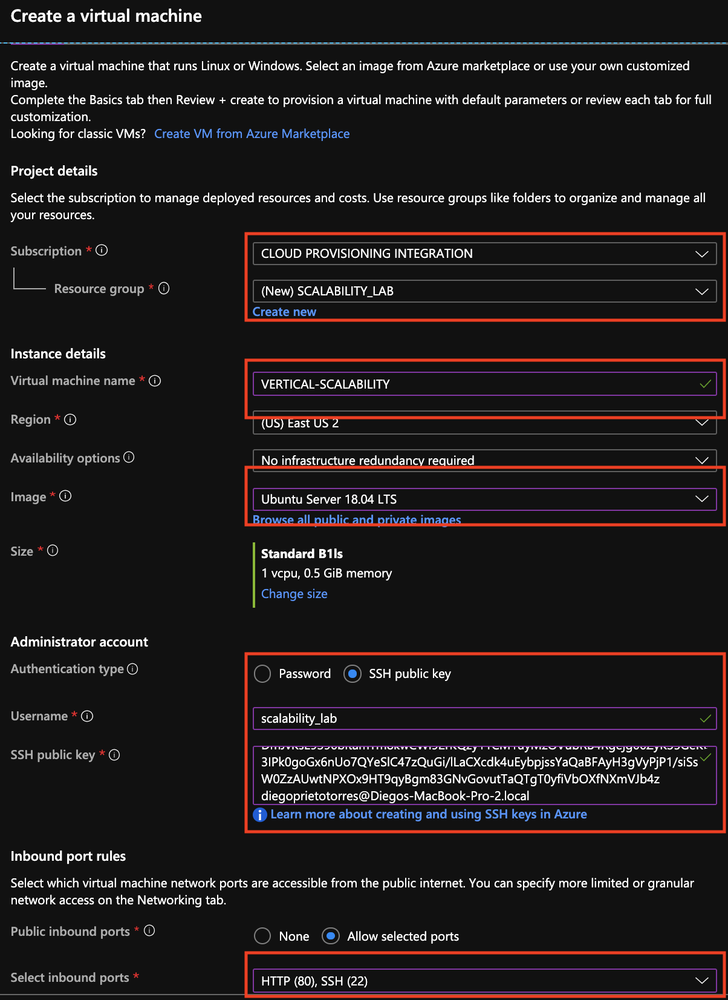

2. Para conectarse a la VM use el siguiente comando, donde las `x` las debe remplazar por la IP de su propia VM (Revise la sección "Connect" de la virtual machine creada para tener una guía más detallada).

    `ssh scalability_lab@xxx.xxx.xxx.xxx`

3. Instale node, para ello siga la sección *Installing Node.js and npm using NVM* que encontrará en este [enlace](https://linuxize.com/post/how-to-install-node-js-on-ubuntu-18.04/).
4. Para instalar la aplicación adjunta al Laboratorio, suba la carpeta `FibonacciApp` a un repositorio al cual tenga acceso y ejecute estos comandos dentro de la VM:

    `git clone <your_repo>`

    `cd <your_repo>/FibonacciApp`

    `npm install`

5. Para ejecutar la aplicación puede usar el comando `npm FibinacciApp.js`, sin embargo una vez pierda la conexión ssh la aplicación dejará de funcionar. Para evitar ese compartamiento usaremos *forever*. Ejecute los siguientes comando dentro de la VM.

    ` node FibonacciApp.js`

6. Antes de verificar si el endpoint funciona, en Azure vaya a la sección de *Networking* y cree una *Inbound port rule* tal como se muestra en la imágen. Para verificar que la aplicación funciona, use un browser y user el endpoint `http://xxx.xxx.xxx.xxx:3000/fibonacci/6`. La respuesta debe ser `The answer is 8`.


7. La función que calcula en enésimo número de la secuencia de Fibonacci está muy mal construido y consume bastante CPU para obtener la respuesta. Usando la consola del Browser documente los tiempos de respuesta para dicho endpoint usando los siguintes valores:
    * 1000000
    * 1010000
    * 1020000
    * 1030000
    * 1040000
    * 1050000
    * 1060000
    * 1070000
    * 1080000
    * 1090000    

8. Dírijase ahora a Azure y verifique el consumo de CPU para la VM. (Los resultados pueden tardar 5 minutos en aparecer).

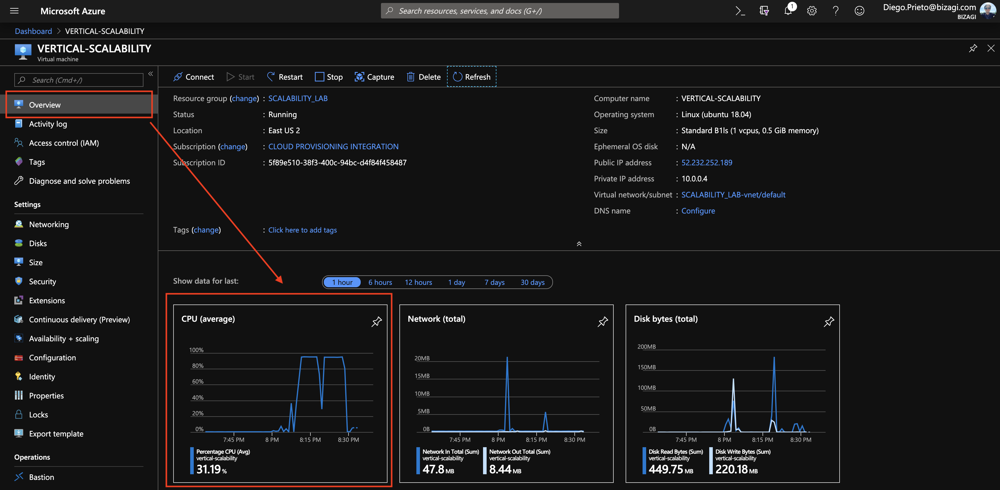

9. Ahora usaremos Postman para simular una carga concurrente a nuestro sistema. Siga estos pasos.
    * Instale newman con el comando `npm install newman -g`. Para conocer más de Newman consulte el siguiente [enlace](https://learning.getpostman.com/docs/postman/collection-runs/command-line-integration-with-newman/).
    * Diríjase hasta la ruta `FibonacciApp/postman` en una maquina diferente a la VM.
    * Para el archivo `[ARSW_LOAD-BALANCING_AZURE].postman_environment.json` cambie el valor del parámetro `VM1` para que coincida con la IP de su VM.
    * Ejecute el siguiente comando.

    ```
    newman run ARSW_LOAD-BALANCING_AZURE.postman_collection.json -e [ARSW_LOAD-BALANCING_AZURE].postman_environment.json -n 10 &
    newman run ARSW_LOAD-BALANCING_AZURE.postman_collection.json -e [ARSW_LOAD-BALANCING_AZURE].postman_environment.json -n 10
    ```

10. La cantidad de CPU consumida es bastante grande y un conjunto considerable de peticiones concurrentes pueden hacer fallar nuestro servicio. Para solucionarlo usaremos una estrategia de Escalamiento Vertical. En Azure diríjase a la sección *size* y a continuación seleccione el tamaño `B2ms`.

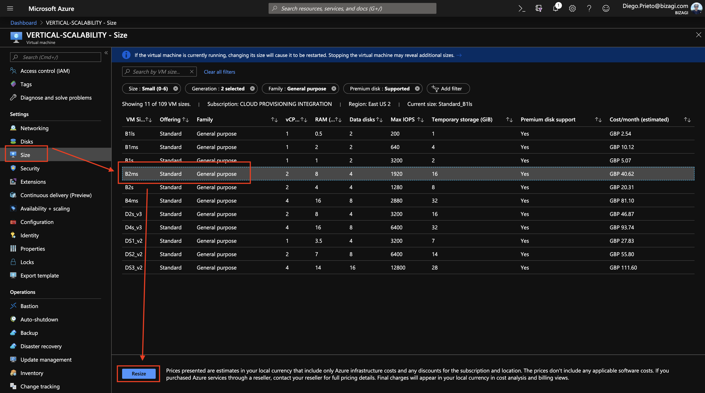

11. Una vez el cambio se vea reflejado, repita el paso 7, 8 y 9.
12. Evalue el escenario de calidad asociado al requerimiento no funcional de escalabilidad y concluya si usando este modelo de escalabilidad logramos cumplirlo.
13. Vuelva a dejar la VM en el tamaño inicial para evitar cobros adicionales.

**Preguntas**

1. ¿Cuántos y cuáles recursos crea Azure junto con la VM?
2. ¿Brevemente describa para qué sirve cada recurso?
3. ¿Al cerrar la conexión ssh con la VM, por qué se cae la aplicación que ejecutamos con el comando `npm FibonacciApp.js`? ¿Por qué debemos crear un *Inbound port rule* antes de acceder al servicio?
4. Adjunte tabla de tiempos e interprete por qué la función tarda tando tiempo.
5. Adjunte imágen del consumo de CPU de la VM e interprete por qué la función consume esa cantidad de CPU.
6. Adjunte la imagen del resumen de la ejecución de Postman. Interprete:
    * Tiempos de ejecución de cada petición.
    * Si hubo fallos documentelos y explique.
7. ¿Cuál es la diferencia entre los tamaños `B2ms` y `B1ls` (no solo busque especificaciones de infraestructura)?
8. ¿Aumentar el tamaño de la VM es una buena solución en este escenario?, ¿Qué pasa con la FibonacciApp cuando cambiamos el tamaño de la VM?
9. ¿Qué pasa con la infraestructura cuando cambia el tamaño de la VM? ¿Qué efectos negativos implica?
10. ¿Hubo mejora en el consumo de CPU o en los tiempos de respuesta? Si/No ¿Por qué?
11. Aumente la cantidad de ejecuciones paralelas del comando de postman a `4`. ¿El comportamiento del sistema es porcentualmente mejor?

### Parte 2 - Escalabilidad horizontal

#### Crear el Balanceador de Carga

Antes de continuar puede eliminar el grupo de recursos anterior para evitar gastos adicionales y realizar la actividad en un grupo de recursos totalmente limpio.

1. El Balanceador de Carga es un recurso fundamental para habilitar la escalabilidad horizontal de nuestro sistema, por eso en este paso cree un balanceador de carga dentro de Azure tal cual como se muestra en la imágen adjunta.


2. A continuación cree un *Backend Pool*, guiese con la siguiente imágen.

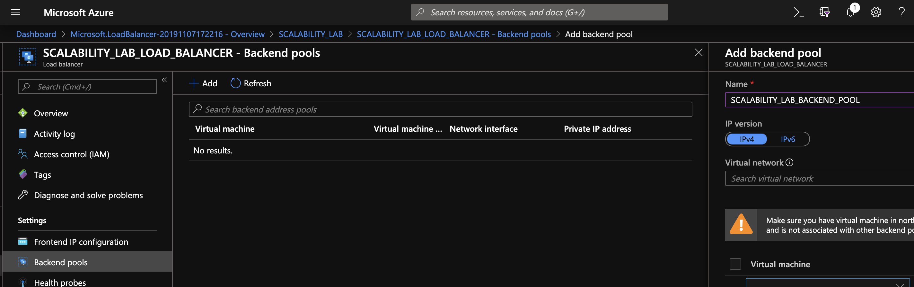

3. A continuación cree un *Health Probe*, guiese con la siguiente imágen.

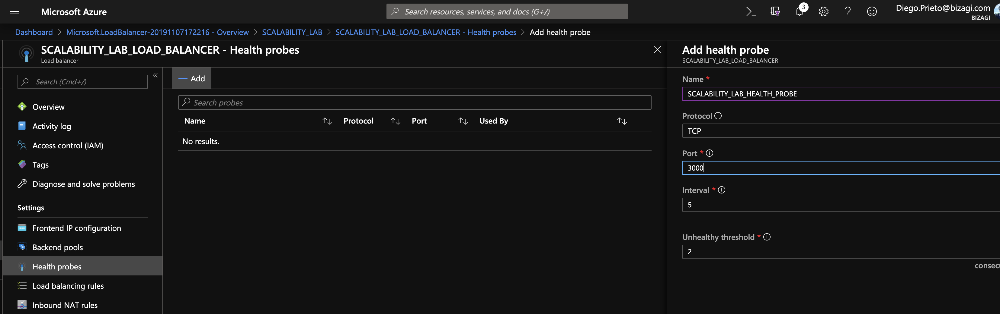

4. A continuación cree un *Load Balancing Rule*, guiese con la siguiente imágen.


5. Cree una *Virtual Network* dentro del grupo de recursos, guiese con la siguiente imágen.


#### Crear las maquinas virtuales (Nodos)

Ahora vamos a crear 3 VMs (VM1, VM2 y VM3) con direcciones IP públicas standar en 3 diferentes zonas de disponibilidad. Después las agregaremos al balanceador de carga.

1. En la configuración básica de la VM guíese por la siguiente imágen. Es importante que se fije en la "Avaiability Zone", donde la VM1 será 1, la VM2 será 2 y la VM3 será 3.


2. En la configuración de networking, verifique que se ha seleccionado la *Virtual Network*  y la *Subnet* creadas anteriormente. Adicionalmente asigne una IP pública y no olvide habilitar la redundancia de zona.


3. Para el Network Security Group seleccione "avanzado" y realice la siguiente configuración. No olvide crear un *Inbound Rule*, en el cual habilite el tráfico por el puerto 3000. Cuando cree la VM2 y la VM3, no necesita volver a crear el *Network Security Group*, sino que puede seleccionar el anteriormente creado.


4. Ahora asignaremos esta VM a nuestro balanceador de carga, para ello siga la configuración de la siguiente imágen.


5. Finalmente debemos instalar la aplicación de Fibonacci en la VM. para ello puede ejecutar el conjunto de los siguientes comandos, cambiando el nombre de la VM por el correcto

```
git clone https://github.com/daprieto1/ARSW_LOAD-BALANCING_AZURE.git

curl -o- https://raw.githubusercontent.com/creationix/nvm/v0.34.0/install.sh | bash
source /home/vm1/.bashrc
nvm install node

cd ARSW_LOAD-BALANCING_AZURE/FibonacciApp
npm install

npm install forever -g
forever start FibonacciApp.js
```

Realice este proceso para las 3 VMs, por ahora lo haremos a mano una por una, sin embargo es importante que usted sepa que existen herramientas para aumatizar este proceso, entre ellas encontramos Azure Resource Manager, OsDisk Images, Terraform con Vagrant y Paker, Puppet, Ansible entre otras.

#### Probar el resultado final de nuestra infraestructura

1. Porsupuesto el endpoint de acceso a nuestro sistema será la IP pública del balanceador de carga, primero verifiquemos que los servicios básicos están funcionando, consuma los siguientes recursos:

```
http://52.155.223.248/
http://52.155.223.248/fibonacci/1
```

2. Realice las pruebas de carga con `newman` que se realizaron en la parte 1 y haga un informe comparativo donde contraste: tiempos de respuesta, cantidad de peticiones respondidas con éxito, costos de las 2 infraestrucruras, es decir, la que desarrollamos con balanceo de carga horizontal y la que se hizo con una maquina virtual escalada.

3. Agregue una 4 maquina virtual y realice las pruebas de newman, pero esta vez no lance 2 peticiones en paralelo, sino que incrementelo a 4. Haga un informe donde presente el comportamiento de la CPU de las 4 VM y explique porque la tasa de éxito de las peticiones aumento con este estilo de escalabilidad.

```
newman run ARSW_LOAD-BALANCING_AZURE.postman_collection.json -e [ARSW_LOAD-BALANCING_AZURE].postman_environment.json -n 10 &
newman run ARSW_LOAD-BALANCING_AZURE.postman_collection.json -e [ARSW_LOAD-BALANCING_AZURE].postman_environment.json -n 10 &
newman run ARSW_LOAD-BALANCING_AZURE.postman_collection.json -e [ARSW_LOAD-BALANCING_AZURE].postman_environment.json -n 10 &
newman run ARSW_LOAD-BALANCING_AZURE.postman_collection.json -e [ARSW_LOAD-BALANCING_AZURE].postman_environment.json -n 10
```

**Preguntas**

* ¿Cuáles son los tipos de balanceadores de carga en Azure y en qué se diferencian?, ¿Qué es SKU, qué tipos hay y en qué se diferencian?, ¿Por qué el balanceador de carga necesita una IP pública?
* ¿Cuál es el propósito del *Backend Pool*?
* ¿Cuál es el propósito del *Health Probe*?
* ¿Cuál es el propósito de la *Load Balancing Rule*? ¿Qué tipos de sesión persistente existen, por qué esto es importante y cómo puede afectar la escalabilidad del sistema?.
* ¿Qué es una *Virtual Network*? ¿Qué es una *Subnet*? ¿Para qué sirven los *address space* y *address range*?
* ¿Qué son las *Availability Zone* y por qué seleccionamos 3 diferentes zonas?. ¿Qué significa que una IP sea *zone-redundant*?
* ¿Cuál es el propósito del *Network Security Group*?
* Informe de newman 1 (Punto 2)
* Presente el Diagrama de Despliegue de la solución.

---

# Desarrollo del laboratorio

**Autor:** Joshua David Quiroga · **Fecha de ejecución:** 29/10/2026 · **Suscripción:** Azure for Students · **Región:** Mexico Central

Todas las capturas de esta sección están en [images/lab/](images/lab/). Los recursos se crearon con Azure CLI desde **Azure Cloud Shell** (los comandos exactos están en la [guía de despliegue](#guía-de-despliegue-paso-a-paso)) y se verificaron en el portal.

## Ajustes respecto al enunciado (instrucciones desactualizadas)

El enunciado es de 2019 y varias instrucciones ya no funcionan tal cual. Esto fue lo que se encontró y cómo se resolvió:

| Enunciado | Situación actual (oct-2026) | Qué se hizo |
|---|---|---|
| Región libre (North Europe en las imágenes) | La suscripción *Azure for Students* de la ECI tiene una política *Allowed resource deployment regions*: solo `brazilsouth`, `canadacentral`, `mexicocentral`, `chilecentral`, `northcentralus`. | Se usó **Mexico Central** (única región permitida con capacidad). |
| VM `Standard_B1ls` | La serie B v1 (`B1ls`, `B1s`, `B2ms`) devuelve `SkuNotAvailable` en **todas** las regiones permitidas. | Tamaño inicial **`Standard_B2ats_v2`** (2 vCPU, 1 GiB, serie B v2 AMD), el más pequeño disponible. |
| Escalar a `B2ms` | `B2ms` → `SkuNotAvailable`. | Se escaló a **`Standard_B4as_v2`** (4 vCPU, 16 GiB). Se descartó `B2as_v2` porque tiene las mismas 2 vCPU que el tamaño inicial. |
| Ubuntu Server (18.04) + nvm 0.34 | Ubuntu 18.04 está fuera de soporte; Node actual (v26) requiere `libatomic1`, que la imagen de Ubuntu 24.04 de Azure no trae. | Imagen **Ubuntu 24.04 LTS**, `nvm v0.40.3`, `nvm install --lts` y `sudo apt-get install -y libatomic1`. |
| `npm FibinacciApp.js` | Comando incorrecto. | `node FibonacciApp.js` (primer plano) o `forever start FibonacciApp.js` (segundo plano). |
| `git clone https://github.com/daprieto1/...` | Repositorio de otro autor. | Se clona este repositorio: `https://github.com/JoshQ10/LAB07_ARSW_Joshua-David-Quiroga.git`. |
| LB SKU *Basic* / IP *Basic* | El SKU Basic de Load Balancer y de IP pública fue retirado (30-sep-2025). | **Standard** para el balanceador y todas las IPs. |
| Una IP pública por VM | La suscripción permite **máximo 3 IPs públicas por región** (`PublicIPCountLimitReached`). | Las VMs **no tienen IP pública**: el SSH entra por **reglas NAT de entrada** del LB (puertos 50001-50003 → 22) y la salida a Internet por una **regla de salida** del LB. Es además la configuración recomendada. |
| VM1, VM2, VM3 en zonas 1, 2 y 3 | La zona 1 de Mexico Central no tiene capacidad para ningún tamaño permitido (x86 ni ARM). | VM1 y VM2 en **zona 2**, VM3 en **zona 3**. |
| Agregar una 4.ª VM | La cuota regional es de **6 vCPU** y el tamaño más pequeño disponible tiene 2 vCPU (3 VMs = 6 vCPU). Se pidió subir la cuota a 8 y **Azure rechazó la solicitud** (ver [Limitaciones](#limitaciones-de-esta-ejecución)). | **No fue posible crear VM4.** La prueba de 4 ejecuciones en paralelo se hizo con 3 VMs. |
| `newman` global | Funciona, pero no hace falta instalarlo globalmente. | `npx newman@6 run ...` |

## Parte 1 - Escalabilidad vertical

Recursos: grupo `SCALABILITY_LAB`, VM `VERTICAL-SCALABILITY`, usuario `scalability_lab`, autenticación con llave SSH, IP `68.155.151.114`.

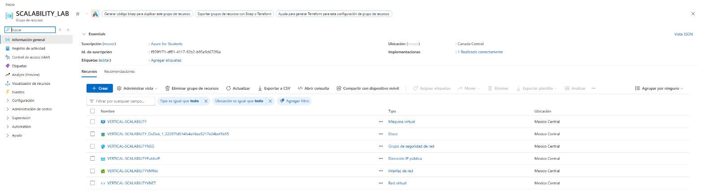
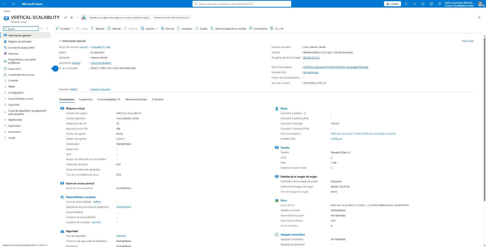
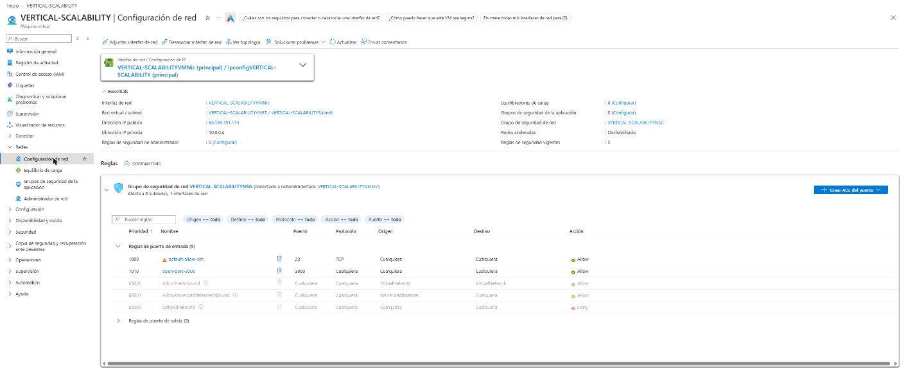

`http://68.155.151.114:3000/fibonacci/6` → `The answer is 8`.

### Resultados

| Métrica | `B2ats_v2` (2 vCPU, 1 GiB) | `B4as_v2` (4 vCPU, 16 GiB) |
|---|---|---|
| Tiempo promedio secuencial (nth 1.000.000 - 1.090.000) | **7 268 ms** | **6 153 ms** (−15 %) |
| CPU máxima durante las pruebas (Avg 1 min) | ~49 % | ~25 % |
| newman 2 en paralelo: éxito | 17/20 (85 %) | 19/20 (95 %) |
| newman 2 en paralelo: tiempo promedio por petición | 10,9 s / 11,2 s | 10,5 s / 10,7 s |
| newman 2 en paralelo: duración de cada corrida | 1 m 44 s | 1 m 46 s / 1 m 42 s |
| newman 4 en paralelo: éxito | 33/40 (82,5 %) | 35/40 (87,5 %) |
| newman 4 en paralelo: tiempo promedio por petición | 16,1 – 23,3 s | 16,0 – 21,5 s |
| Precio de lista (Linux, pago por uso, Mexico Central) | 0,0103 USD/h | 0,165 USD/h (16×) |

Tiempos secuenciales (paso 7):

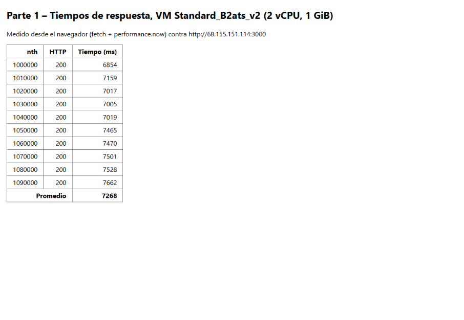
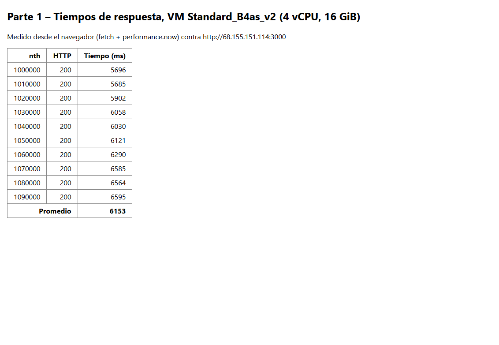

CPU (paso 8). Primer pico: prueba secuencial; segundo: newman ×2; meseta de ~50 %: newman ×4 en `B2ats_v2`; hueco: el *resize*; meseta de ~25 %: todas las pruebas en `B4as_v2`:

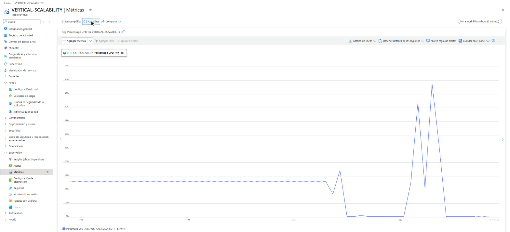
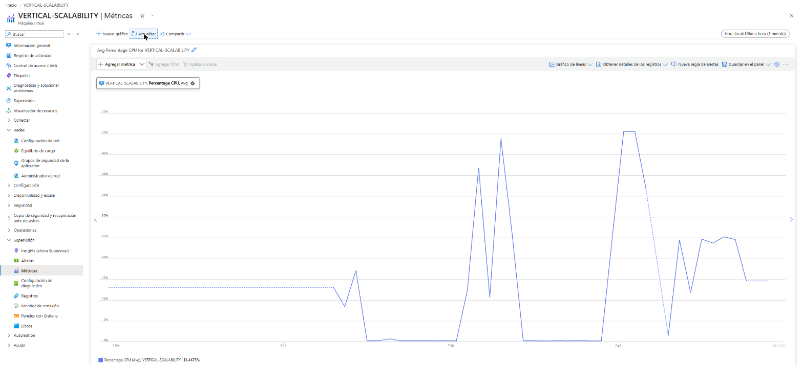

newman (paso 9 y pregunta 11):

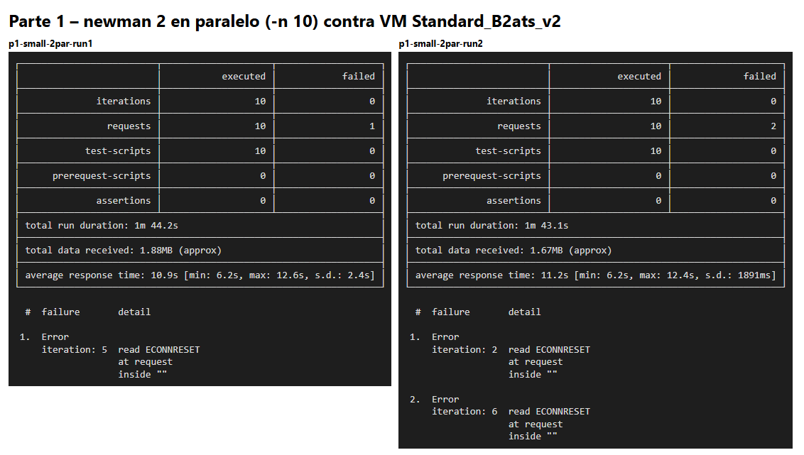
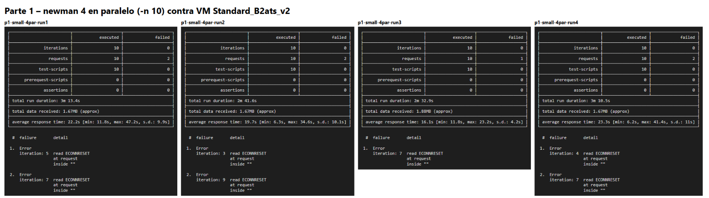
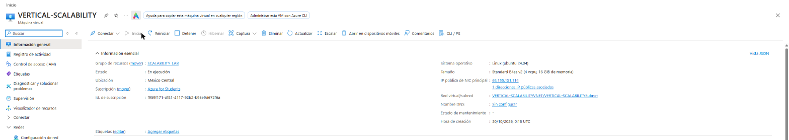
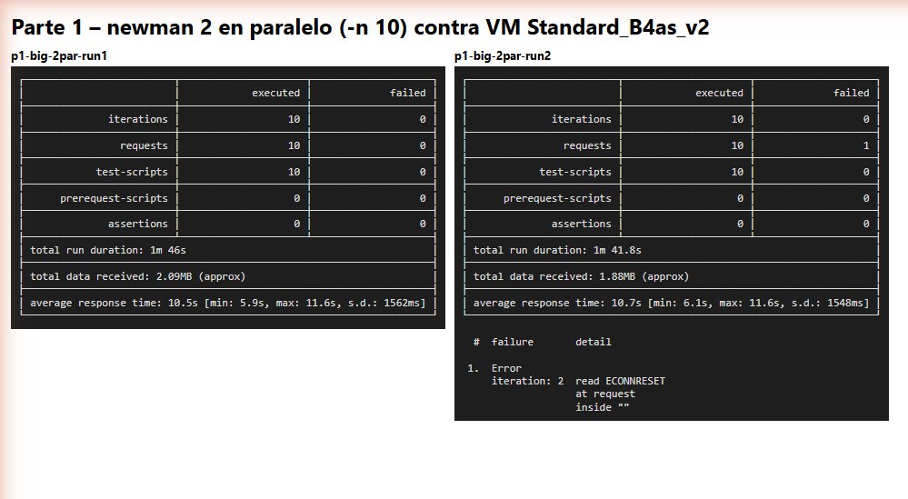
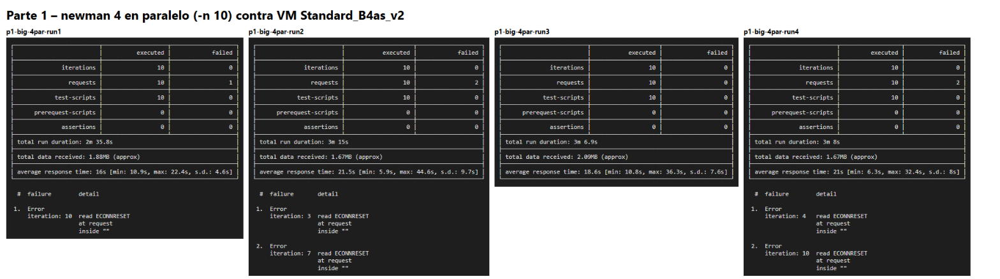

**Evaluación del escenario de calidad (paso 12):** **no se cumple**. Con ambos tamaños hubo peticiones fallidas (5 % – 17,5 %). El límite de CPU del 70 % sí se respeta, pero solo porque Node usa un núcleo: con 2 vCPU el techo es 50 % y con 4 vCPU es 25 %. La CPU no es el límite: la petición sigue esperando en la cola del único hilo. Al terminar se devolvió la VM a `Standard_B2ats_v2` (paso 13) y luego se eliminó el grupo de recursos para liberar cuota para la Parte 2.

### Respuestas - Parte 1

1. **¿Cuántos y cuáles recursos crea Azure junto con la VM?** Seis: la máquina virtual, el disco del SO (`..._OsDisk_...`), la interfaz de red (`...VMNic`), la red virtual con su subred (`...VNET`), el grupo de seguridad de red (`...NSG`) y la dirección IP pública (`...PublicIP`).
2. **¿Para qué sirve cada recurso?**
   - **VM:** el cómputo (vCPU y RAM) donde corre el SO y la aplicación.
   - **Disco administrado:** almacenamiento persistente del SO. Sobrevive a reinicios y *resizes*.
   - **NIC:** conecta la VM a la subred. Tiene la IP privada y referencia la IP pública y el NSG.
   - **VNet/Subnet:** la red privada aislada en la que vive la VM (aquí 10.0.0.0/16 y 10.0.0.0/24).
   - **NSG:** firewall con estado, con reglas de entrada y salida por puerto, protocolo y origen.
   - **IP pública:** la dirección enrutable desde Internet para llegar a la VM (SSH y puerto 3000).
3. **¿Por qué se cae la app al cerrar SSH? ¿Por qué la *Inbound port rule*?** Un proceso lanzado en primer plano desde la sesión SSH es hijo de la shell. Al cerrar la sesión, la shell recibe `SIGHUP` y se lo propaga a sus hijos, que terminan. `forever` (o `nohup`, `pm2`, `systemd`) desacopla el proceso de la terminal. La regla de entrada es necesaria porque el NSG, por defecto, niega todo el tráfico entrante desde Internet (`DenyAllInBound`) salvo SSH (22). Sin la regla, los paquetes al 3000 se descartan antes de llegar a la VM.
4. **Tabla de tiempos e interpretación.** Ver la tabla y las capturas: ~6,9 – 7,7 s por petición en `B2ats_v2`, creciendo con *n*. El algoritmo es iterativo O(n) en número de sumas, pero cada suma es de `BigInteger`: F(10⁶) tiene ~209 000 dígitos y cada suma cuesta O(dígitos). El costo total es ~O(n²) operaciones de dígito. Además, cada iteración crea objetos nuevos (presión sobre el *garbage collector*) y la respuesta transfiere ~210 KB de texto. Con fast doubling o exponenciación de matrices bastarían O(log n) multiplicaciones.
5. **Consumo de CPU.** Ver gráficas: cada petición usa el 100 % de **un** núcleo durante ~7 s. Como Node.js ejecuta el JavaScript en un único hilo (event loop) y el cálculo es síncrono, la métrica de la VM muestra ~50 % con 2 vCPU y ~25 % con 4 vCPU: un núcleo saturado y los demás ociosos.
6. **Resumen de newman.**
   - *Tiempos:* con 2 clientes concurrentes cada petición tarda ~10,5 – 11 s (casi el doble que sola), porque el event loop las atiende **una tras otra**: la segunda espera a que termine la primera. Con 4 clientes sube a 16 – 23 s, con picos de 35 – 47 s.
   - *Fallos:* `read ECONNRESET`. El proceso no se cayó (`forever list` mostró el mismo uptime y no hubo OOM). La causa es que el servidor HTTP de Node cierra las conexiones *keep-alive* inactivas tras `keepAliveTimeout` = 5 s. Mientras atiende un cálculo de 7 s, el event loop está bloqueado. Cuando se libera, primero se ejecutan los temporizadores vencidos y se cierran sockets que ya tenían una nueva petición en cola, así que el cliente recibe un RST. Es un efecto directo de bloquear el event loop. Más concurrencia implica más fallos.
7. **Diferencia entre `B2ms` y `B1ls` (y los tamaños usados).** Ambas son **burstables (serie B)**: tienen un rendimiento base garantizado y acumulan *créditos de CPU* cuando están por debajo de él, que gastan para ráfagas hasta el 100 %. `B1ls` tiene 1 vCPU, 0,5 GiB y una línea base del 5 %, y fue pensada para cargas mínimas. `B2ms` tiene 2 vCPU, 8 GiB y una línea base del 60 %. Cambia también el ancho de banda de red, los discos/IOPS máximos y el precio. En este laboratorio: `B2ats_v2` tiene 2 vCPU AMD, 1 GiB y una línea base del 20 %, a 0,0103 USD/h; `B4as_v2` tiene 4 vCPU, 16 GiB y una línea base del 40 %, a 0,165 USD/h. Con carga sostenida, una B se queda sin créditos y se limita a su línea base, lo cual degrada mucho una app CPU-bound.
8. **¿Es buena solución aumentar el tamaño? ¿Qué pasa con la app?** No en este escenario. La app es monohilo, así que las vCPU adicionales no se usan: el tiempo mejoró solo ~15 % (CPU algo más rápida y sin limitación por créditos) y siguieron los fallos. Además, el *resize* **reinicia la VM** y la app quedó caída (`No forever processes running`, HTTP 000) hasta volver a lanzar `forever start` a mano. Para evitarlo hay que registrar la app como servicio (systemd, `pm2 startup`).
9. **¿Qué pasa con la infraestructura al cambiar el tamaño?** Azure detiene la VM, la puede reubicar en otro host físico que soporte el nuevo tamaño y la vuelve a encender. El disco y la IP pública estática se conservan. Efectos negativos: **indisponibilidad** durante el cambio (~1 min aquí), pérdida de procesos y estado en memoria, la posibilidad de que el tamaño no tenga capacidad (como pasó con `B2ms`), costo 16 veces mayor y un **techo**: siempre existe un tamaño máximo y la VM sigue siendo un punto único de falla.
10. **¿Hubo mejora en CPU o tiempos?** Sí, pero marginal: ~15 % menos de tiempo secuencial y la CPU de la VM bajó del 50 % al 25 %. No por eficiencia, sino porque hay más núcleos ociosos. En concurrencia los tiempos fueron prácticamente iguales (10,5 vs 10,9 s), porque el cuello de botella es el único hilo de Node, no la cantidad de CPU.
11. **Con 4 ejecuciones paralelas, ¿es porcentualmente mejor?** Muy poco: la tasa de éxito pasó de 82,5 % a 87,5 % y el tiempo promedio por petición quedó en 16 – 22 s en ambos casos (cuatro veces el tiempo individual, porque se atienden en serie). Duplicar las vCPU no duplicó la capacidad: el escalamiento vertical no sirve para una app que no aprovecha los núcleos.

## Parte 2 - Escalabilidad horizontal

Recursos en el grupo `SCALABILITY_LAB_HORIZONTAL` (Mexico Central): balanceador `SCALABILITY_LAB_LOAD_BALANCER` (Standard, público), IP `SCALABILITY_LAB_LOAD_BALANCER_IP` = **68.155.81.100** (Standard, estática, *zone-redundant*), VNet `SCALABILITY_LAB_VIRTUAL_NETWORK` 10.1.0.0/16 con subred `SCALABILITY_LAB_SUBNET` 10.1.0.0/24, NSG `LOAD_BALANCER_NSG` (22 y 3000) y VMs `VM1` (zona 2, 10.1.0.6), `VM2` (zona 2, 10.1.0.4) y `VM3` (zona 3, 10.1.0.5), todas `Standard_B2ats_v2` con Ubuntu 24.04, Node 26 y `forever`.

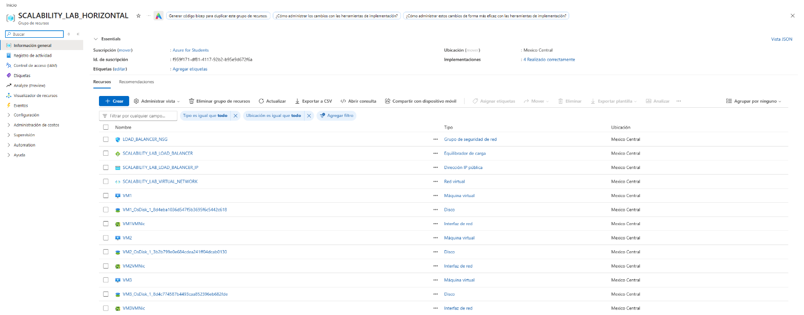
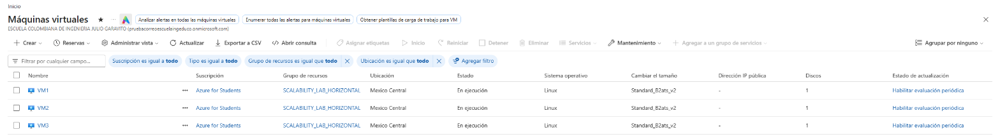
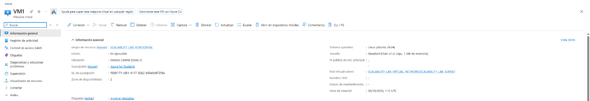

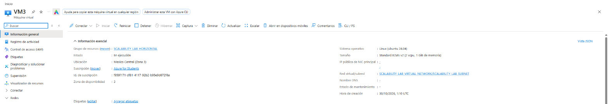
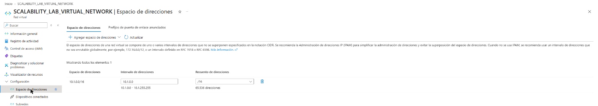
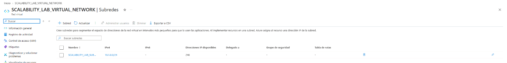
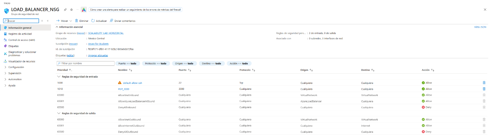
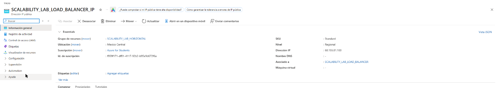
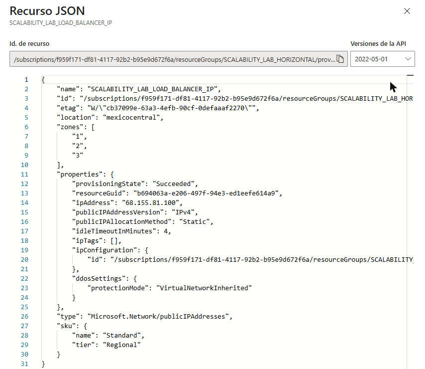
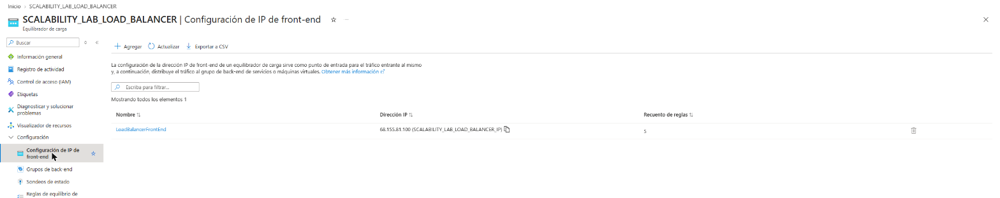
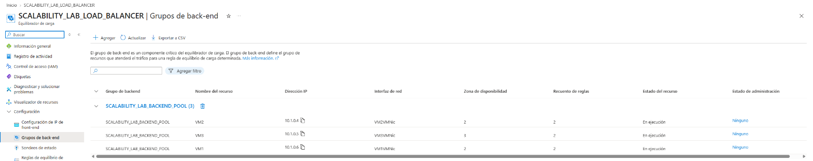
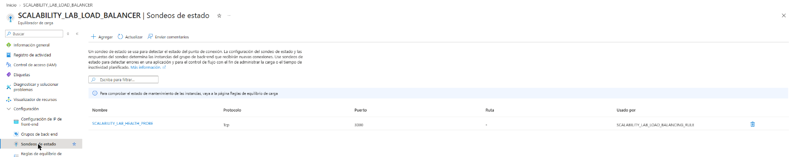
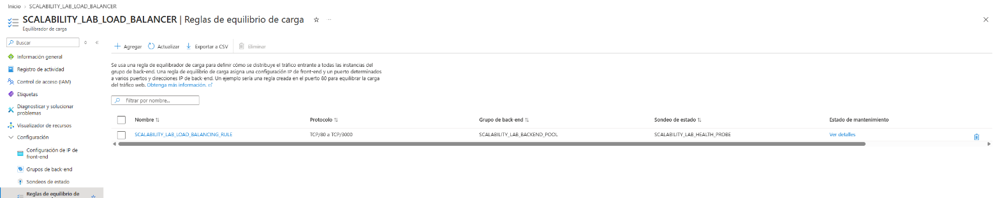
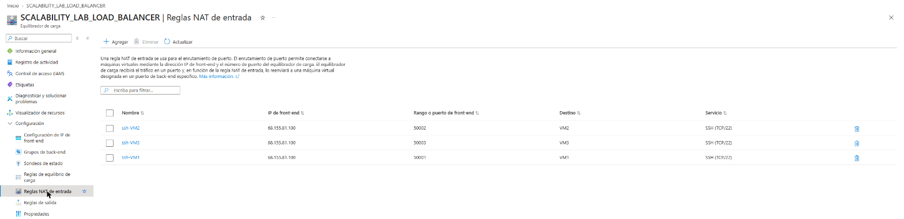
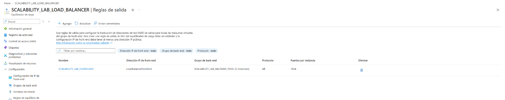

Prueba básica: `http://68.155.81.100/` → `Hello World`; `http://68.155.81.100/fibonacci/1` → `The answer is 1`.

### Informe comparativo (newman, `-n 10`, nth = 1.000.000)

| | Vertical `B2ats_v2` | Vertical `B4as_v2` | **Horizontal 3 × `B2ats_v2` + LB** |
|---|---|---|---|
| 2 paralelos: éxito | 85 % | 95 % | **100 %** (20/20) |
| 2 paralelos: tiempo promedio por petición | 10,9 – 11,2 s | 10,5 – 10,7 s | **6,6 – 6,7 s** |
| 2 paralelos: duración de la corrida | 1 m 44 s | 1 m 42 s – 1 m 46 s | **1 m 7 s – 1 m 8 s** |
| 4 paralelos: éxito | 82,5 % | 87,5 % | **90 %** (36/40) |
| 4 paralelos: tiempo promedio por petición | 16,1 – 23,3 s | 16,0 – 21,5 s | **6,3 – 9,8 s** |
| 4 paralelos: duración de la corrida | 2 m 33 s – 3 m 13 s | 2 m 36 s – 3 m 15 s | **1 m 4 s – 1 m 28 s** |
| vCPU totales | 2 | 4 | 6 |
| Costo de cómputo + red (USD/h, precio de lista) | 0,0103 + 0,005 IP ≈ **0,015** | 0,165 + 0,005 IP ≈ **0,170** | 3 × 0,0103 + 0,005 IP + ~0,025 LB Standard ≈ **0,061** |
| Costo aproximado al mes (730 h, sin discos) | ~11 USD | ~124 USD | ~45 USD |

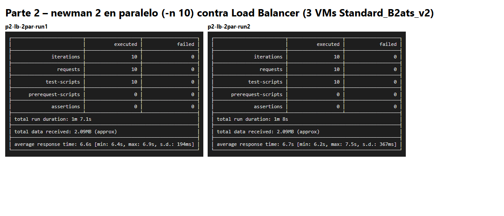
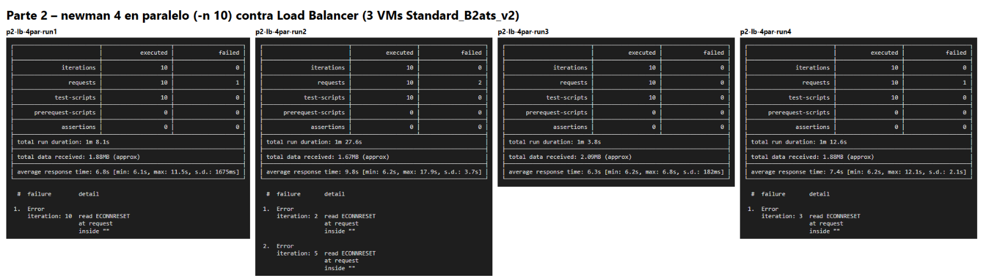

CPU de las 3 VMs durante las pruebas (8:15-8:16 con 2 paralelos; 8:17-8:19 con 4). La carga se reparte y ninguna VM pasa del ~48 %:

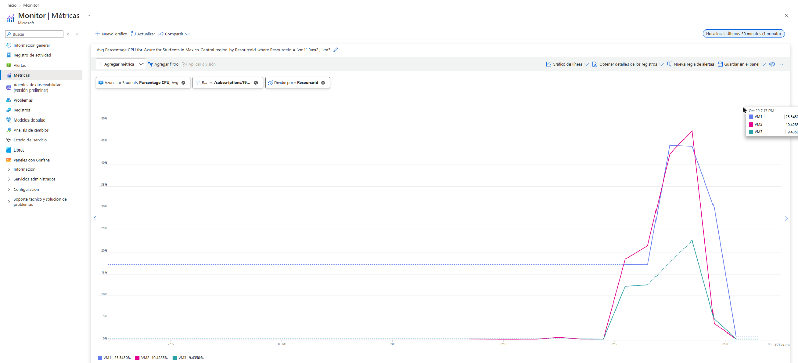

**Conclusión.** Con 2 clientes concurrentes, la arquitectura horizontal cumple el escenario de calidad: 100 % de peticiones respondidas, CPU < 70 % y tiempos iguales a los de una petición aislada. Además cuesta ~2,8 veces menos que la VM grande. Cada cliente cae en un nodo distinto y nadie hace cola. Con 4 clientes sobre 3 nodos, el hash de 5 tuplas inevitablemente pone dos conexiones en el mismo nodo y reaparece la cola, con algunos `ECONNRESET`. La tasa de éxito aumenta con este estilo de escalabilidad porque cada nodo agrega **un hilo de ejecución más** (justo el recurso que escasea en Node) y porque el LB saca de rotación los nodos que no responden. Con 4 nodos (punto 3 del enunciado) cada cliente tendría su propio nodo. Para eso se necesita un aumento de cuota de vCPU (ver limitaciones).

> Nota sobre la serie B: `B2ats_v2` tiene una línea base del 20 %. Bajo carga sostenida por horas se agotarían los créditos y el rendimiento caería; para producción convendría una serie D/F.

### Respuestas - Parte 2

- **Tipos de balanceador, SKU y por qué la IP pública.** En Azure hay varios tipos:
  - **Load Balancer** (capa 4, TCP/UDP, regional; público o interno).
  - **Application Gateway** (capa 7 HTTP/S, con WAF, enrutamiento por ruta o host y terminación TLS).
  - **Front Door** (capa 7 global, CDN y WAF en el edge).
  - **Traffic Manager** (balanceo global por DNS).
  - **Gateway Load Balancer** (para insertar appliances de red).

  El **SKU** es el nivel o edición del recurso. El Load Balancer tiene *Basic* (retirado en 2025: sin zonas, sin SLA, hasta 300 instancias, abierto por defecto), *Standard* (zonal o zone-redundant, SLA 99,99 %, hasta 1000 instancias, seguro por defecto con NSG, reglas de salida, métricas) y *Gateway*. Las IPs públicas también tienen SKU *Basic* (retirado) y *Standard* (estática, zone-redundant, cerrada por defecto). El LB necesita una IP pública porque es el **único punto de entrada** visible desde Internet: los clientes se conectan a esa IP de frontend y el LB reenvía a las IPs privadas del backend. Un LB interno no la necesita.
- **Backend Pool:** el conjunto de destinos (NICs/IPs de las VMs) entre los que el LB reparte el tráfico. Agregar o quitar instancias del pool es escalar horizontalmente.
- **Health Probe:** verifica periódicamente cada instancia (aquí TCP:3000 cada 5 s). Si una no responde, el LB deja de enviarle nuevas conexiones hasta que se recupere. Así se evita mandar tráfico a una VM con la app caída.
- **Load Balancing Rule y persistencia de sesión.** La regla asocia frontend IP:puerto (80/TCP) con backend pool:puerto (3000) y una sonda. Define cómo se reparte el tráfico, el *idle timeout* y si se usa IP flotante. La persistencia de sesión puede ser *None* (hash de 5 tuplas: IP y puerto de origen, IP y puerto de destino, protocolo; usada aquí), *Client IP* (hash de 2 tuplas: mismo cliente → mismo nodo) o *Client IP and protocol* (3 tuplas). Importa cuando la app guarda estado en memoria (sesiones, carritos): sin afinidad, el usuario podría caer en otro nodo y "perder" su sesión. A cambio, la afinidad **perjudica la escalabilidad**: la carga se desbalancea (muchos usuarios detrás de un NAT van a un solo nodo), los nodos nuevos no reciben clientes existentes y la caída de un nodo pierde sesiones. Lo ideal es una app *stateless* con el estado en un almacén externo (Redis, BD).
- **Virtual Network, Subnet, address space y address range.** Una **VNet** es una red privada aislada en Azure donde los recursos se comunican entre sí con IPs privadas. Una **Subnet** es un segmento de la VNet, al que se pueden aplicar NSG y rutas propias. El **address space** es el bloque CIDR total de la VNet (10.1.0.0/16 = 65 536 direcciones) y el **address range** de la subred es el sub-bloque que esta toma (10.1.0.0/24 = 256 direcciones; Azure reserva 5). Sirven para planear el direccionamiento sin solapamientos (peering, VPN) y segmentar por capas.
- **Availability Zones, 3 zonas y *zone-redundant*.** Una zona es un datacenter (o grupo de ellos) físicamente separado dentro de una región, con energía, red y refrigeración independientes. Repartir las VMs en zonas distintas hace que la falla de un datacenter no tumbe el servicio: SLA de 99,99 % frente a 99,9 % de una VM. Una IP *zone-redundant* se publica desde todas las zonas a la vez, así que sigue respondiendo aunque falle cualquiera de ellas. Una IP *zonal* muere con su zona. En este despliegue la zona 1 no tenía capacidad, así que las VMs quedaron en las zonas 2 y 3: el servicio resiste la caída de una zona, pero no reparte en tres.
- **Network Security Group:** firewall distribuido con estado, asociado a NIC o subred. Filtra tráfico entrante y saliente por IP, puerto y protocolo con reglas priorizadas. Aquí deja entrar 22 (SSH vía NAT) y 3000 (tráfico del LB); el resto se niega (`DenyAllInBound`). Con un LB Standard es obligatorio, porque Standard es "cerrado por defecto".
- **Informe de newman 1 (punto 2):** ver la tabla comparativa y las capturas anteriores.
- **Diagrama de despliegue:**

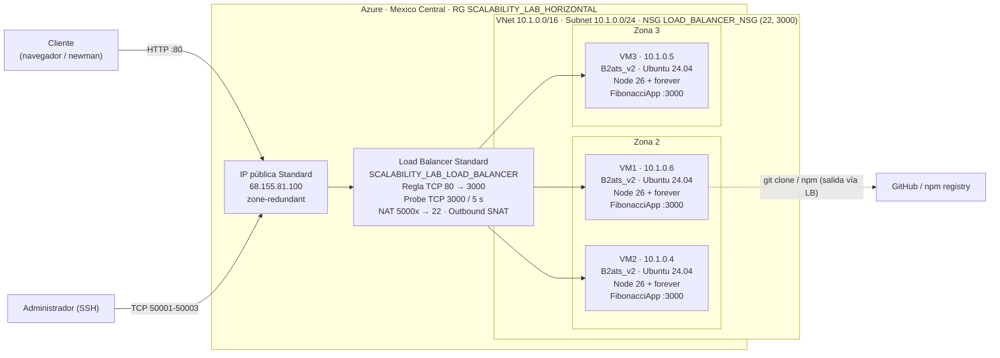

## Guía de despliegue paso a paso

Requisitos: cuenta Azure (aquí *Azure for Students*), una llave SSH (`ssh-keygen -t ed25519 -f ~/.ssh/lab07_azure`) y el repositorio público en GitHub. Los comandos se ejecutan en **Azure Cloud Shell** (portal → icono `>_` → Bash → "No se requiere cuenta de almacenamiento"), donde `az` ya viene autenticado.

### 0. Preparación

```bash
az account set -s <ID_SUSCRIPCION>
az policy assignment list --query "[].parameters" -o json   # regiones permitidas
az vm list-usage -l mexicocentral -o table                  # cuotas (cores, familias)
KEY="ssh-ed25519 AAAA... usuario@equipo"                    # pegar aquí la llave pública
```

### 1. Parte 1: VM única

```bash
az group create -n SCALABILITY_LAB -l mexicocentral
az vm create -g SCALABILITY_LAB -n VERTICAL-SCALABILITY --image Ubuntu2404 \
  --size Standard_B2ats_v2 --admin-username scalability_lab \
  --ssh-key-values "$KEY" --public-ip-sku Standard
az vm open-port -g SCALABILITY_LAB -n VERTICAL-SCALABILITY --port 3000 --priority 1010
```

Si sale `SkuNotAvailable`, pruebe otro tamaño o región permitida. Equivalente en el portal: *Máquinas virtuales → Crear*, con los mismos datos, y luego *Redes → Configuración de red → Crear regla de puerto de entrada* (puerto 3000).

### 2. Instalar la aplicación en la VM

```bash
ssh -i ~/.ssh/lab07_azure scalability_lab@<IP_VM>
sudo apt-get update && sudo apt-get install -y libatomic1
curl -o- https://raw.githubusercontent.com/nvm-sh/nvm/v0.40.3/install.sh | bash
source ~/.bashrc
nvm install --lts
git clone https://github.com/JoshQ10/LAB07_ARSW_Joshua-David-Quiroga.git
cd LAB07_ARSW_Joshua-David-Quiroga/FibonacciApp
npm install
npm install -g forever
forever start FibonacciApp.js
curl localhost:3000/fibonacci/6     # The answer is 8
```

### 3. Pruebas (desde su equipo, no desde la VM)

```bash
cd FibonacciApp/postman/part1        # ajustar VM1 en el environment
npx newman@6 run ARSW_LOAD-BALANCING_AZURE.postman_collection.json -e "[ARSW_LOAD-BALANCING_AZURE].postman_environment.json" -n 10 &
npx newman@6 run ARSW_LOAD-BALANCING_AZURE.postman_collection.json -e "[ARSW_LOAD-BALANCING_AZURE].postman_environment.json" -n 10
```

CPU: portal → VM → *Supervisión → Métricas* → `Percentage CPU`, *Última hora*, granularidad *1 minuto*.

### 4. Escalar verticalmente y volver

```bash
az vm resize -g SCALABILITY_LAB -n VERTICAL-SCALABILITY --size Standard_B4as_v2
# la VM se reinicia: volver a entrar por SSH y ejecutar
#   cd LAB07_ARSW_Joshua-David-Quiroga/FibonacciApp && forever start FibonacciApp.js
az vm resize -g SCALABILITY_LAB -n VERTICAL-SCALABILITY --size Standard_B2ats_v2
az group delete -n SCALABILITY_LAB --yes   # libera cuota para la parte 2
```

### 5. Parte 2: red y balanceador

```bash
RG=SCALABILITY_LAB_HORIZONTAL; L=mexicocentral; LB=SCALABILITY_LAB_LOAD_BALANCER
POOL=SCALABILITY_LAB_BACKEND_POOL; VNET=SCALABILITY_LAB_VIRTUAL_NETWORK; SUB=SCALABILITY_LAB_SUBNET; NSG=LOAD_BALANCER_NSG
az group create -n $RG -l $L
az network vnet create -g $RG -n $VNET --address-prefix 10.1.0.0/16 --subnet-name $SUB --subnet-prefix 10.1.0.0/24
az network public-ip create -g $RG -n SCALABILITY_LAB_LOAD_BALANCER_IP --sku Standard --allocation-method Static --zone 1 2 3
az network lb create -g $RG -n $LB --sku Standard --public-ip-address SCALABILITY_LAB_LOAD_BALANCER_IP \
  --frontend-ip-name LoadBalancerFrontEnd --backend-pool-name $POOL
az network lb probe create -g $RG --lb-name $LB -n SCALABILITY_LAB_HEALTH_PROBE --protocol Tcp --port 3000 --interval 5
az network lb rule create -g $RG --lb-name $LB -n SCALABILITY_LAB_LOAD_BALANCING_RULE --protocol Tcp \
  --frontend-port 80 --backend-port 3000 --frontend-ip-name LoadBalancerFrontEnd --backend-pool-name $POOL \
  --probe-name SCALABILITY_LAB_HEALTH_PROBE --load-distribution Default --disable-outbound-snat true
az network lb outbound-rule create -g $RG --lb-name $LB -n SCALABILITY_LAB_OUTBOUND \
  --frontend-ip-configs LoadBalancerFrontEnd --protocol All --address-pool $POOL
az network nsg create -g $RG -n $NSG
az network nsg rule create -g $RG --nsg-name $NSG -n default-allow-ssh --priority 1000 --destination-port-ranges 22 --protocol Tcp
az network nsg rule create -g $RG --nsg-name $NSG -n Port_3000 --priority 1010 --destination-port-ranges 3000 --protocol "*"
```

En el portal, el orden es el mismo: *Equilibradores de carga → Crear* (Standard, Público, IP nueva *zone-redundant*), y luego en el LB: *Grupos de back-end*, *Sondeos de estado*, *Reglas de equilibrio de carga*, *Reglas de salida* y *Reglas NAT de entrada*.

### 6. Parte 2: nodos (repetir para VM1, VM2, VM3 con su zona y puerto NAT)

```bash
N=VM1; Z=2; P=50001
az vm create -g $RG -n $N --zone $Z --image Ubuntu2404 --size Standard_B2ats_v2 \
  --admin-username scalability_lab --ssh-key-values "$KEY" \
  --vnet-name $VNET --subnet $SUB --nsg $NSG --public-ip-address ""
az network nic ip-config address-pool add -g $RG --nic-name ${N}VMNic --ip-config-name ipconfig$N --lb-name $LB --address-pool $POOL
az network lb inbound-nat-rule create -g $RG --lb-name $LB -n ssh-$N --protocol Tcp --frontend-port $P --backend-port 22 --frontend-ip-name LoadBalancerFrontEnd
az network nic ip-config inbound-nat-rule add -g $RG --nic-name ${N}VMNic --ip-config-name ipconfig$N --lb-name $LB --inbound-nat-rule ssh-$N
```

Instalar la app en cada nodo: `ssh -i ~/.ssh/lab07_azure -p 5000X scalability_lab@<IP_LB>` y repetir el paso 2.

### 7. Verificar y probar

```bash
curl http://<IP_LB>/              # Hello World
curl http://<IP_LB>/fibonacci/1   # The answer is 1
cd FibonacciApp/postman/part2     # ajustar "loadbalancer" en el environment
npx newman@6 run ARSW_LOAD-BALANCING_AZURE.postman_collection.json -e "[ARSW_LOAD-BALANCING_AZURE].postman_environment.json" -n 10 &   # ×2 o ×4
```

CPU de todos los nodos: *Monitor → Métricas → Ámbito* (seleccionar VM1, VM2 y VM3) → `Percentage CPU` (se divide por `ResourceId` automáticamente).

### 8. Limpieza (evitar cobros)

```bash
az vm deallocate --ids $(az vm list -g SCALABILITY_LAB_HORIZONTAL --query "[].id" -o tsv)   # detener (sigue cobrando IP, LB y discos)
az group delete -n SCALABILITY_LAB_HORIZONTAL --yes                                          # eliminar todo
```

## Limitaciones de esta ejecución

- **VM4 / prueba con 4 nodos:** no se pudo crear por la cuota regional de 6 vCPU (`az vm create` → `QuotaExceeded`). Se solicitó el aumento a 8 en *Cuotas → Proceso → vCPU regionales totales → Mexico Central* y **Azure lo rechazó automáticamente** para la suscripción *Azure for Students*: remite a una solicitud de soporte técnico. Por eso el punto 3 de la Parte 2 se dejó con 3 VMs. Con una cuota mayor bastaría con repetir el paso 6 con `N=VM4`.

  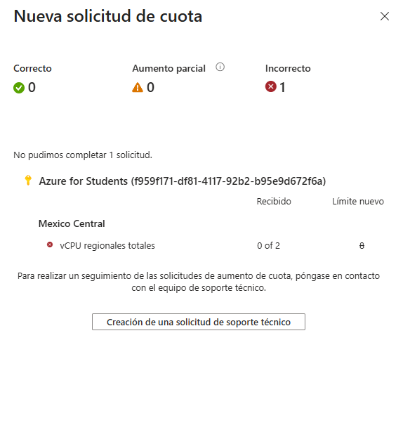
- **Zona 1:** sin capacidad en Mexico Central al momento de la prueba. VM1 quedó en la zona 2.
- Los tiempos medidos dependen de la conexión del cliente (Colombia → Mexico Central) y de los créditos de CPU de la serie B.


